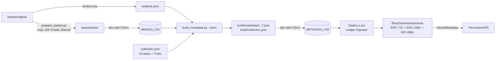

# Blue Dimension Genesis – NFT-Kollektion

Sieben 1/1-Werke von DJ Jesse Jay. Neon-Rails, Voxel-Skylines und Signal-Gold, kuratiert aus elf Quellbildern, mit IPFS-Metadaten, ERC-2981-Royalties und einem einfrierbaren ERC-721-Contract.

## 1. Bildanalyse

Messwerte aus `tools/analyze.py` (Rohdaten in `analysis.json`). Neon Index = Anteil Pixel mit Saettigung und Helligkeit > 60 %.

| Datei | Aufloesung | Frames | Luminanz | Saettigung | Neon | Dominanz | Entscheid |
|---|---|---|---|---|---|---|---|
| 00 Neon Drive | 2848x1600 | 1 | 0.23 | 0.57 | 0.11 | #0E1220 | hold |
| 01 Bern Polka Express | 1672x941 | 1 | 0.20 | 0.88 | 0.35 | #020532 | Token 1 |
| 02 Zuerisee Dub | 1672x941 | 1 | 0.19 | 0.89 | 0.29 | #020625 | Token 2 |
| 03 Pixel Signature | 1933x813 | 1 | 0.37 | 0.82 | 0.28 | #00133D | Token 3 |
| 04 @R† Seal | 800x1280 (Screenshot) | 1 | 0.15 | 0.03 | 0.00 | #000000 | Token 4 (Crop 800x900) |
| 05 Vinyl Roots | 1672x941 | 1 | 0.17 | 0.54 | 0.02 | #0C161B | Token 5 |
| 06 97.5 | 1672x941 | 1 | 0.67 | 0.41 | 0.15 | #532F34 | hold |
| 07 Infographic 25+ | 1672x941 | 1 | 0.53 | 0.35 | 0.02 | #070C2F | exclude |
| 08 BSS Genre Router | 800x450 GIF | 80 | 0.26 | 0.66 | 0.11 | #021530 | Token 6 (animiert) |
| 09 Logo Codex | 1672x941 | 1 | 0.36 | 0.60 | 0.15 | #020A18 | Token 7 |
| 10 TwoDivision Banner | 1280x426 | 1 | 0.06 | 0.94 | 0.01 | #000A1C | Collection-Banner |

Visuelle Lesart:

- Kernstil: Synthwave-Neon (Cyan/Magenta auf Nachtblau). Bern Polka Express und Zuerisee Dub haben die hoechste Leuchtdichte (35 % bzw. 29 %) und tragen die Kollektion.
- Identitaets-Achse: Pixel Signature, @R† Seal und Logo Codex. Das Logo-System (Signal Gold, Signal Cyan, Deep Blue, Charcoal) ist konsistent und als Brand-Token sinnvoll.
- Zeitachse: Vinyl Roots (Gold/Nachtblau, fotografisch) erzaehlt 1997 bis Blue Dimension und bricht bewusst mit dem Neon-Look.
- Bewegung: BSS Genre Router ist das einzige animierte Werk (80 Frames, 16 MB) und verbindet die Kollektion mit dem MusicGenreClassification-Projekt.

## 2. Rechte- und Risiko-Review

| Werk | Befund | Massnahme |
|---|---|---|
| Neon Drive | Serienfahrzeug mit erkennbarem Hersteller-Emblem und Kuehlergrill | Nicht minten. Emblem und Grill entfernen, Karosserie generisch neu generieren |
| 97.5 | Wasserzeichen eines KI-Tools, LR-Kuerzel und Frequenz von Radio LoRa | Nutzungsbedingungen pruefen, schriftliche Freigabe des Senders einholen |
| Infographic | Klarname, Namen dritter Kuenstler, Generator-Wasserzeichen | Nur Presse-Kit |
| @R† Seal | Original war Smartphone-Screenshot mit UI-Elementen, nur 800 px breit | Crop umgesetzt. Hochaufloesende Vektorfassung nachliefern. ®-Zeichen nur verwenden, wenn die Marke eingetragen ist (Swissreg/EUIPO), sonst irrefuehrend |
| BSS Genre Router | Enthaelt staatliches Hoheitszeichen (DDR-Emblem-Anmutung) und Retro-Game-Figuren | Vor Mainnet-Mint pruefen, ob einzelne Figuren bekannten Spielcharakteren entsprechen |
| Alle | KI-gestuetzt erzeugt. In CH/EU ist Urheberrechtsschutz rein maschinell erzeugter Inhalte unsicher | KI-Hinweis steht in jedem Token (`properties.ai_disclosure`, Trait "Creation"). Lizenz CC BY-NC 4.0 auf das Bild, Markenrechte vorbehalten |

## 3. Architektur



Contract `contracts/src/BlueDimensionGenesis.sol`:

- ERC-721 (OpenZeppelin 5.1), feste Maximalmenge, IDs 1..7, jede ID genau einmal.
- Nur Owner mintet, kein Public Mint, kein Ether im Contract, keine Withdraw-Logik als Angriffsflaeche.
- Ownable2Step gegen Fehltransfer der Ownership.
- ERC-2981 Royalties, Standard 7.5 %, harte Obergrenze 10 %.
- `setBaseURI` / `setContractURI` bis `freezeMetadata()`, danach unveraenderlich, `PermanentURI`-Events fuer Marktplaetze.
- `contractURI()` fuer Collection-Name, Banner und Royalty-Anzeige.

## 4. Pipeline

```bash
cd nft
make analyze            # Bildanalyse
make metadata           # Assets + Metadaten mit Platzhalter-CID (Review)
make test               # forge test (Unit + Fuzz)
make pin                # Kubo lokal: IMAGES_CID, dann METADATA_CID
export OWNER=0x...  ROYALTY_RECEIVER=0x...  METADATA_CID=bafy...
make deploy-testnet     # Base Sepolia, Ledger
```

Mainnet erst nach: `make metadata-strict` gruen, Testnet-Mint auf Marktplatz-Testumgebung visuell geprueft, Freeze bewusst ausgefuehrt.

Sicherheitsregeln:

- Kubo-API nur auf 127.0.0.1 (`pin.sh` bricht sonst ab). Kein oeffentlicher Port 5001.
- Kein Private Key in `.env` oder CI. Signatur nur per Ledger (`--ledger`) oder verschluesseltem Keystore (`cast wallet import`).
- `fee_recipient` in `collection.json` vor dem Strict-Build setzen (aktuell Null-Adresse, Strict-Build schlaegt bewusst fehl).

## 5. Verifikation

| Pruefung | Ergebnis |
|---|---|
| solc 0.8.26, Optimizer 200 | kompiliert ohne Warnungen, Runtime 6 696 Bytes (EIP-170 Limit 24 576) |
| EVM-Smoke-Test (15 Faelle: Mint, ID-Grenzen, Doppel-Mint, Zugriff, Royalty, Interfaces, Freeze, 2-Step-Owner) | 15/15 bestanden |
| Foundry-Suite `contracts/test` inkl. Fuzz (1024 Runs) | laeuft in CI (`.github/workflows/nft.yml`) |
| `build_metadata.py --strict` | schlaegt erwartungsgemaess fehl, bis CID und Royalty-Empfaenger gesetzt sind |
